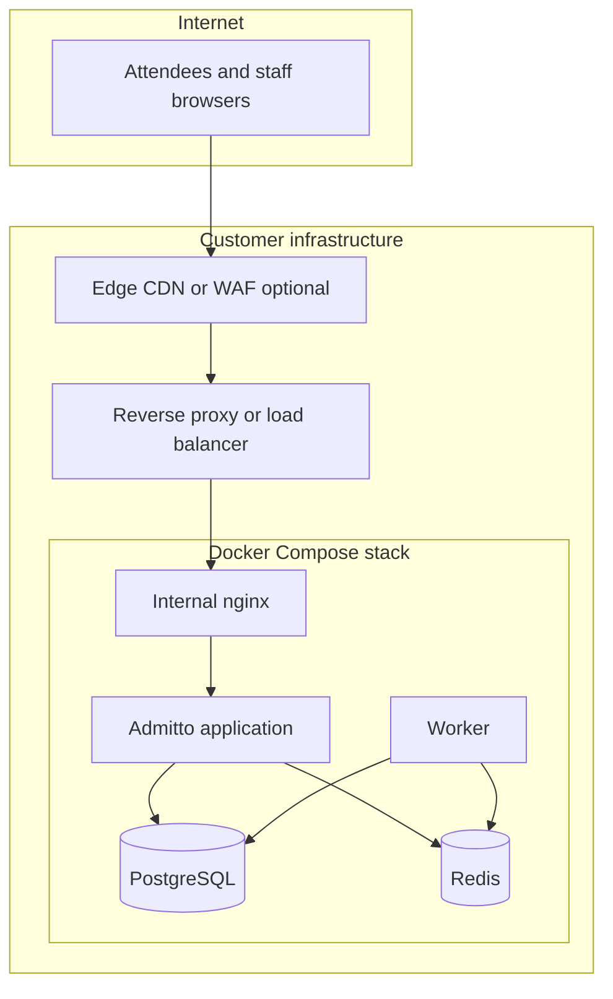

# Corporate Deployment Model

Admitto is an **internal event access gateway** deployed **on infrastructure controlled by the
customer**. There is **no multi-tenant SaaS**: each deployment is a dedicated instance with its
own database, secrets, and operator access.

> **You need a technical resource.** Admitto is not a click-to-install product. Deploying and
> maintaining it (see "What the customer provides" below) requires a developer or an IT
> contractor comfortable with Docker, a reverse proxy, and a mail relay. If you don't have that
> in-house, budget for one before committing to a go-live date.

> **Product maturity:** check [VERSIONING.md](../../VERSIONING.md) and the current release tag
> before committing to a go-live date. Stability status is tracked there, not restated here, so
> this document doesn't go stale between releases.

---

## Deployment model at a glance

| Aspect | Approach |
|--------|----------|
| Hosting | **Self-hosted** (customer VPC, private cloud, or on-premises) |
| SaaS | **No** - single-tenant per deployment |
| Data region | **Customer choice** (EU is the documented target for GDPR-oriented deployments) |
| Orchestration | **Docker Compose** (supported production path for MVP) |
| Container image | Published from semver tags on the project registry; CI-created tags are unsigned by default, with a signed-tag path for emergencies - see [VERSIONING.md](../../VERSIONING.md) |
| Secrets | Customer `.env` / secret manager - never committed to git |

---

## What the customer provides

| Component | Role |
|-----------|------|
| **Application container** | Web API, admin UI, check-in UI. Give it at least 1 GB of memory, see [Memory for the app container](../../deploy/README.md#memory-for-the-app-container) |
| **PostgreSQL** | Primary data store (not exposed to the public internet) |
| **Redis** (required, password-protected) | Rate limiting, live-update pub/sub between worker and application, caches, shared PassCreator call pacing. Sessions are stored in PostgreSQL, not Redis. What the keys and messages contain: [DATA-PROTECTION.md](../../DATA-PROTECTION.md#redis) |
| **Worker container** | Same image as the application, exactly one replica, no listening port. Sends queued mail, runs imports/exports, bounce ingest, wallet jobs and scheduled retention purges |
| **Migration job** | One-shot `migrate` service that applies schema changes before the application starts. Run only one at a time per database, see [Container startup](../../deploy/README.md#container-startup-entrypoint) |
| **Internal reverse proxy** | Bundled in compose; publishes loopback port to the host |
| **Edge TLS / public routing** | Customer reverse proxy, load balancer, or CDN |
| **DNS** | Customer-controlled |
| **Transactional email** | Customer Microsoft 365 / Graph and/or corporate SMTP relay |
| **Backups** | Customer policy (manual pre-upgrade `pg_dump` + nightly `db-backup` compose service) |
| **Monitoring** | Customer tools; application exposes liveness and token-gated readiness endpoints |

Optional **wallet pass** integration (PassCreator) adds a third-party pass provider when enabled
per event - see [SUBPROCESSORS.md](SUBPROCESSORS.md).

---

## Reference topology

Typical mid-size or enterprise layout (components vary by customer):

**Common patterns:**

| Pattern | Examples | Notes |
|---------|----------|-------|
| Edge / CDN | Cloudflare, corporate CDN, WAF | TLS, DDoS, optional staff URL protection |
| Reverse proxy | nginx, **Nginx Proxy Manager**, HAProxy, cloud LB | Forwards to loopback port `8080` on the docker host |
| Private access | Corporate VPN, zero-trust client | Staff reach origin without public admin exposure |
| On-prem | No public CDN | Proxy on LAN; attendees may use separate public hostname |

The application origin should **not** be wide-open on the internet for staff functions - customers
define whether staff paths are VPN-only, zero-trust gated, or public with strong app auth.

---

## Data residency

- Attendee personal data, check-in records, and audit data remain in the **customer's PostgreSQL**.
- No central vendor database of customer events.
- Cross-border transfer is a **customer compliance** decision (region selection, DPA, SCCs).

---

## Roles and access paths

| Role | Typical user | Access |
|------|--------------|--------|
| Platform owner | IT / platform team | Admin UI; may combine with perimeter controls |
| Event organizer | Business owner | Admin UI, organization scope |
| Check-in operator | On-site staff | Operator UI, event scope |
| Attendee | Guest | Public ticket link - no account |

- The initial platform administrator (a superadmin) is created in the browser on first start. With an empty database, every staff URL redirects to `/setup`.
- The CLI (`docker compose run --rm app node packages/auth/dist/cli.js bootstrap-superadmin --email ...`) remains as a break-glass path when the web UI is unavailable.

## Guest registration (0.8)

Checklist for IT: [An event's own address for guests](../../deploy/README.md#an-events-own-address-for-guests-checklist-for-it). Points that matter for review:

- **Company sign-in for guests.** Map `claim_email` to an attribute the directory administrator controls, and limit an event with a claim such as `tid` or a group. A self-editable attribute lets someone register under another person's address. Admitto treats `email_verified: false` as a refusal and a missing claim as consent (Microsoft Entra ID does not send it).
- **Address of the event.** Put it on a domain whose sibling subdomains you trust: a taken-over sibling can set a cookie for the parent domain ("cookie tossing") and get around the login CSRF protection.
- **Sensitive answers** (for example health) are stored without application-level encryption. Require disk and database encryption and restricted access to backups.
- **Path rules on the proxy.** Keep `@hono/node-server` at 2.1.6 or newer: it answers 400 to a raw backslash in the path, which older versions read as `/`.

---

## Upgrade and rollback

1. Take a manual database backup (see `deploy/README.md`).
2. Pull the new container image tag.
3. Update compose image reference.
4. Restart stack - the one-shot `migrate` service applies schema changes; there is no automatic pre-migration dump.
5. Verify health endpoints.

Rollback: previous image tag (no schema change) or database restore from your pre-upgrade backup or a nightly dump.
Details in `deploy/README.md`.

---

## Documentation map for reviewers

| Topic | Document |
|-------|----------|
| CI / supply chain | [SECURITY.md](../../SECURITY.md) |
| Security capabilities | [SECURITY-CONTROLS.md](SECURITY-CONTROLS.md) |
| Architecture | [ARCHITECTURE-FOR-AUDITORS.md](ARCHITECTURE-FOR-AUDITORS.md) |
| Privacy | [DATA-PROTECTION.md](../../DATA-PROTECTION.md), [GDPR-ONE-PAGER.md](GDPR-ONE-PAGER.md) |
| Incidents | [INCIDENT-RESPONSE.md](INCIDENT-RESPONSE.md) |

---

## Explicit non-goals (MVP)

- Vendor-managed multi-tenant hosting
- Kubernetes as the only supported install path
- Built-in high availability across regions
