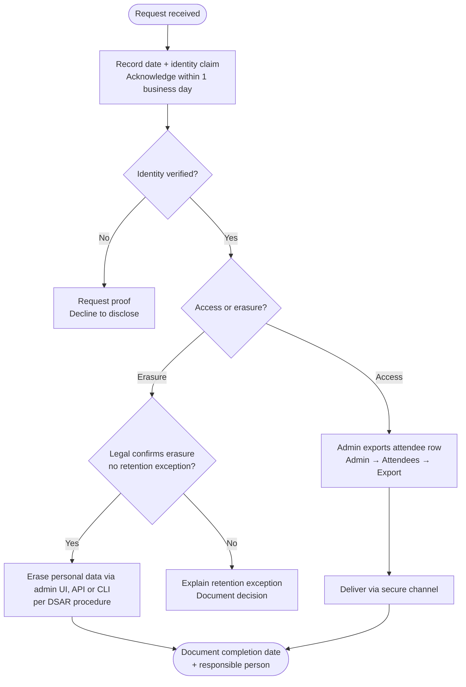

# Data Subject Access and Erasure: Organizer-Mediated Procedure (Option B)

A template for deployments that **do not** use self-service DSAR APIs. Adapt it to your organisation's privacy policy and legal sign-off. **Not legal advice.**

See also: [GDPR-ONE-PAGER.md](GDPR-ONE-PAGER.md) (Option B).

---

## Process overview



---

## 1. Intake

- A request arrives (email, helpdesk, in person). Record the **date received**, the requester's identity and the event.
- The privacy officer, or a designated organizer, acknowledges receipt within **one business day**.

## 2. Verify identity

- Match the requester to an attendee record (email, ticket reference, or an ID checked by the organizer). A guest who registered through the event form may never have become an attendee. Match them to their registration instead (name or email).
- If you cannot verify identity, do not disclose data. Explain what proof is required.

## 3. Access (export)

1. An organizer with the `admin` role exports the attendee row: **Admin → Attendees → Export** (CSV, XLSX or PDF, filtered to the data subject if needed).
2. Deliver the export through your organisation's **secure channel** (encrypted mail, ticket system).
3. Log who exported, when, and for which event. Use your internal audit process.

## 4. Erasure

Start only after legal confirms that erasure is required and no retention exception applies.

There are three actions. Pick one by the reason:

| Situation | Action | Reports |
|-----------|--------|---------|
| A privacy request from an attendee | **Erase personal data** (the recommended path) | Do not change. The entry stays as an anonymous attendee |
| A privacy request from a guest who registered through the event form and was not accepted (waiting, rejected, not confirmed) | **Delete registration** ([4.3](#43-delete-a-guest-registration)) | Do not change. The registration is deleted for good |
| An entry that should never have existed: a duplicate, a test person, a row from the wrong import file | **Remove from event** | Change. The attendee is deleted for good |

**Remove from event** is not the way to answer a privacy request. It is refused on an archived event, whose numbers are final. An archived event is still answered with **Erase personal data**.

After either action, remove copies from local exports, mail logs and backups, per your backup policy. Then document the completion date and the responsible person.

### 4.1 Erase personal data

**What it does.** It anonymises the attendee in place. It also works when the event is archived.

- **Erased:** name, email, company, notes, custom answers, ticket link, copies of the messages sent, the wallet pass at the provider, the person's address in saved import results, and the name and answers of the companion they brought. Nothing that identifies the person or opens their ticket is left. The exact list is in [attendee-erasure.md](../dev/attendee-erasure.md).
- **Kept:** the entry, as an anonymous attendee. The Reports totals do not change.
- **Capacity:** it changes by the attendee's place and one for each companion. A person who had not checked in yet, on an event that is not archived, is marked cancelled, so their places become free.

**How**

- **One attendee:** **Admin → Attendees → attendee detail → More actions → Erase personal data**. Type the attendee's name to confirm.
- **Several attendees:** select the rows on the **Attendees** list, then **More actions → Erase personal data** in the bulk bar. You type no name, because there is no single name to type.

**Files still to import.** Admitto keeps nothing that identifies an erased person, so it cannot refuse a file that lists them.

- An import or an export of the event that is waiting or running is stopped by the erasure.
- A file that someone uploads afterwards adds the person back.
- Remove the person from any spreadsheet that is still to be imported.

**Audit.** The event action log and the central admin audit log record who erased how many people and which ids, never a name or an address. The page of the erased person says who erased them and when. A Superadmin also sees the address it was done from.

**Direct API fallback.** Use an authenticated staff session and a CSRF token.

- One attendee: `POST /api/admin/events/:eventId/attendees/:id/erase`
- Several: `POST /api/admin/events/:eventId/attendees/bulk-erase` with `{ "attendeeIds": [...] }`

Repeating a request for people who are already erased changes nothing. It only tries the pending wallet deletes again.

**No admin UI or API at all.** Use the emergency CLI. See [Erasure without the admin UI](#erasure-without-the-admin-ui-cli-fallback).

#### Wallet pass after an erasure

Everything personal inside Admitto is gone either way. If the wallet provider cannot be reached, a dialog says the pass is still there and offers **Try again**. It repeats only the wallet step. The attendee's page keeps a **Try again** button until it has worked.

| What you see | What it means | What to do |
|--------------|---------------|------------|
| For about ten minutes after the erasure, the dialog can say that a pass Admitto never recorded is still there, although the provider has none | A pass that was being made at that moment can still reach the provider, so Admitto asks again later | Wait, or use **Try again**, the same command, or the daily retention run |
| Admitto keeps reporting the pass as still there, and the provider says the id also belongs to another pass (as its barcode value) | Admitto deletes nothing in this case | Remove the pass in the provider's own console |
| System logs shows `wallet_pass_untracked_deleted`, with the event id and how many | A pass that Admitto never managed to record (its save failed, or the event's template changed while it was being made) was found and deleted. Admitto finds it by the id it wrote on the attendee's pass row before it called the provider | Nothing |
| System logs shows `wallet_pass_found_after_settling` | A pass reached the provider after Admitto settled on "no pass". The daily retention run found it within a week and deleted it | Nothing |
| A pass was made before that id was written, by a request that died without leaving anything on the row | Admitto cannot find it | Delete it in the provider's own console, by its User provided ID, `admitto:<event id>:<attendee id>` |

**The code `wallet_credential_changed`.** The pass was made under an earlier Template ID or API key of the event, and it could not be deleted then. Admitto never marks such a pass as removed on its own, because it cannot tell which account a pass is in. A row can also carry the mark `unknown`. It means the same, except that the id of the pass is not known. Treat it the same way.

1. Delete the pass in the earlier account's console, by its User provided ID, `admitto:<event id>:<attendee id>`.
2. Ask whoever runs the database to clear the marker on the pass row:

   ```sql
   UPDATE "WalletPass" SET left_behind_pass_id = NULL WHERE attendee_id = '<attendee id>'
   ```

3. Run the erasure again. Admitto settles the row as usual.

Do **not** use **Remove from event** for such a person before these steps are done. It deletes the row, and with it the mark and the only record of the pass.

### 4.2 Remove from event

Use it for a mistake only. It deletes the attendee for good, so Reports change with it.

**How**

- **One attendee:** **Admin → Attendees → attendee detail → More actions → Remove from event**. Choose a reason and type the attendee's name to confirm.
- **Several attendees:** select the rows on the **Attendees** list, then **More actions → Remove from event** in the bulk bar. Choose a reason. You type no name, because there is no single name to type.

**What gets removed and audited**

- Dependent delivery, wallet and check-in rows are removed in one transaction. The notes, the attendee's own activity log and their companions go with the row.
- The address is also blanked on mail that staff addressed to the person on behalf of another attendee, and in the saved results of the event's imports.
- The event action log gets an entry: `attendee_erased`, or one `attendees_bulk_erased` entry for a bulk removal. It is told apart from an erasure by `method: "remove"`.
- The central admin audit log gets an entry too: one per single removal, one per bulk request.
- Both entries hold the reason code, the attendee ids and the removed-row counts only, never a name or email.
- The name and email in the person's creation entry of the central log are blanked too.
- Entries written by the old hard delete, before Erase and Remove were separate, still hold them. See [DATA-PROTECTION.md](../../DATA-PROTECTION.md#central-admin-audit-log-adminauditlog) for how to blank those after your retention window.

**Direct API fallback.** If the SPA is unavailable, use an authenticated staff session and a CSRF token (the same session model as other admin mutations).

- One attendee: `POST /api/admin/events/:eventId/attendees/:id/remove` with `{ "reason": "duplicate" }`
- Several: `POST /api/admin/events/:eventId/attendees/bulk-remove` with `{ "attendeeIds": [...], "reason": "duplicate" }`

The reasons are `duplicate`, `test_person`, `wrong_import`, `added_by_mistake` and `other`.

#### Wallet pass after a removal

Before the local delete, Admitto asks the wallet provider to delete each removed attendee's pass, so the name no longer sits there. This is best effort. If a provider call fails, the attendee is still removed locally.

**After every removal, check System logs** (live tail, superadmin).

- A `wallet_pass_erasure_delete_failed` entry means a call failed. Remove the remaining pass by hand in the provider's own console.
- Where the provider could not answer before the local delete, Admitto asks once more after it. It writes one entry for the whole removal, not one for each pass. The entry names the attendee ids (`attendeeIds`) of the passes that are still at the provider. Find them in the provider's console by their User provided ID, `admitto:<event id>:<attendee id>`, or by the one the entry names in `reservedIds`.

Admitto also deletes a pass that it never managed to record (its save failed, or the event's template changed while it was being made). It finds it by the id it wrote on the attendee's pass row before it called the provider. The same holds for a pass that a failed creation may have left.

| What you see | What it means | What to do |
|--------------|---------------|------------|
| The provider says the id also belongs to another pass (as its barcode value), and the entry names the attendee | Admitto deletes nothing for that attendee | Remove that pass in the provider's own console |
| Nothing is sent, and no failure entry is written | The event's wallet template or API key is no longer configured (for example, removed after the pass was issued). Once the local row is gone, Admitto no longer knows which provider pass belonged to the attendee | Restore the credentials in Event Settings → Wallet before you remove, or delete the attendee's pass in the provider's own console yourself |
| A pass is still being made at the moment of the removal | The request that makes it deletes it. If that request dies first, the pass stays at the provider. An erasure asks again for ten minutes, but a removal has no row to ask from | Delete the pass in the provider's own console |
| A pass was made before that id was written, by a request that died without leaving anything on the row | Admitto does not find it | Delete the pass in the provider's own console |

### 4.3 Delete a guest registration

Use it for a guest who registered through the event form and asks to delete their data. They may never have become an attendee. Their registration (name, address, answers, a companion's name and answers, and when the terms were accepted) is personal data too, and no other action removes it.

**What it does**

- A registration that is waiting for the address, waiting for a decision, on the waiting list or rejected is deleted for good, with its queued mail. The confirmation link the guest was sent finds nothing. The guest can register again with the address.
- An accepted registration is an attendee as well. Deleting it erases the attendee exactly as **Erase personal data** does ([4.1](#41-erase-personal-data)): the ticket stops working, the wallet pass is deleted at the provider, and the Reports totals do not change. The place is free again, unless the person was already admitted or the event is archived.
- It also works when the event is archived.
- Nothing is mailed to the guest.

**Find the registration.** `GET /api/admin/events/:eventId/registrations?q=<name or email>` lists the registrations that match, in every state. Its answer names people, so keep it out of tickets and chat.

**How.** Use an authenticated staff session and a CSRF token (the same session model as other admin mutations).

- One or several registrations: `POST /api/admin/events/:eventId/registrations/delete` with `{ "ids": [...] }`. You can delete up to 500 at a time. An id that is not a registration of this event answers `gone`.
- Everything a filter selects: `POST /api/admin/events/:eventId/registrations/delete-by-filter` with `{ "status": "rejected", "older_than": "90d", "expected": <total>, "selection_digest": <selection_digest> }`. Use the same parameters as the list (`status`, `older_than`, `q`, and at least one of them), and the `total` and `selection_digest` the list gave for them. Admitto reads the filter again before it deletes. If the number is not the one you were given, if the registrations are not the ones the list showed, or if there are more than 500, it deletes nothing and says so.

**How long to keep registrations.** Admitto deletes only the registrations that were never confirmed, 24 hours after the submission. Waiting, rejected and accepted registrations stay until you delete them. Your organisation decides how long to keep them.

**Audit.** The event action log and the central admin audit log get a `registrations_deleted` entry: the registration ids, the attendee ids of the accepted ones and the counts. They never hold a name, an address or the words of a search. An accepted registration also leaves the usual erasure entry.

**Backups and mail.** A restore from a backup brings back what was deleted, so repeat the deletions from the ids in the audit entries. Mail the guest already received stays in their mailbox and in the Sent Items of your mail provider.

### Erasure without the admin UI (CLI fallback)

A privacy request does not wait for the admin UI. When the UI and the API cannot be reached, but the database can, run the emergency CLI from the same image the app runs from.

It does what the erase API does:

- anonymises the attendees in place
- blanks their addresses in saved import results
- writes the same audit entries, marked `source: "cli"`
- deletes the files the event's exports and imports left in storage
- deletes each attendee's wallet pass at the provider

**Steps**

1. **Find the ids.** This only reads.

   ```bash
   docker compose run --rm app node apps/cli/dist/index.js attendees find --query "<name or email>"
   ```

   - It lists up to 20 people whose name or address contains the text, in every event. For each person it shows the event id and title, the attendee id and the address. So you find the event id too, and you can tell two people with the same name apart.
   - Add `--event <eventId>` to look in one event only.
   - It works for an archived event too. `checkin lookup` does not, because check-in is locked there.
   - People who are already erased are not listed.
   - If more than 20 match, it says so. Narrow the query, for example to the whole address.
   - Its output names people, so keep it out of tickets and chat. The erase command prints counts and ids only.
   - A person in several events is erased event by event.

2. **Preview.** It says how many would be erased, how many are erased already and how many ids match nobody. It changes nothing.

   ```bash
   docker compose run --rm app node apps/cli/dist/index.js attendees erase --event <eventId> --attendee-ids <id>[,<id>...] --operator-email <your superadmin email> --dry-run
   ```

3. **Erase.** Run the same command without `--dry-run`. It asks you to type `yes` first (`--yes` skips the question, for a script). You can erase up to 500 ids at a time.

**Good to know**

- **Audit:** the event action log and the central admin audit log record who erased how many people and which ids (`method: "erase"`, `source: "cli"`), never a name or an address. `--operator-email` is required for the real run. It names the actor, whom the page of the erased person then shows, as done on the emergency command line.
- **Wallet pass:** if the provider cannot be reached, or the event's wallet credentials are no longer set, the command prints how many passes are still there and exits with code 2. Run the same command again. People who are already erased are left alone, and only their passes are tried again. Or let the worker's daily retention run do it. If a pass keeps failing, fix the wallet credentials in Event settings, or delete the pass in the provider's own console.
- **Open admin screens** show the change within 30 seconds. The CLI does not notify them.
- **Not offered here:** **Remove from event** (a hard delete for mistakes) stays in the admin UI and API. It changes Reports, and it is not an emergency. **Delete registration** ([4.3](#43-delete-a-guest-registration)) stays in the API too, so a guest who was not accepted has no command here. For a guest who was accepted, `attendees erase` deletes the registration with the attendee. The old manual SQL delete is gone. It bypassed both audit writers and the wallet provider, and it removed the entry instead of erasing the personal data.

## 5. SLA (customer-defined)

| Step | Suggested target |
|------|------------------|
| Acknowledge request | 1 business day |
| Fulfil access or erasure | Per applicable law (for example **one month** under GDPR Art. 12(3)). Shorten it internally if your policy requires |

---

## Related documents

- [GDPR-ONE-PAGER.md](GDPR-ONE-PAGER.md)
- [DATA-PROTECTION.md](../../DATA-PROTECTION.md)
- [INCIDENT-RESPONSE.md](INCIDENT-RESPONSE.md)
