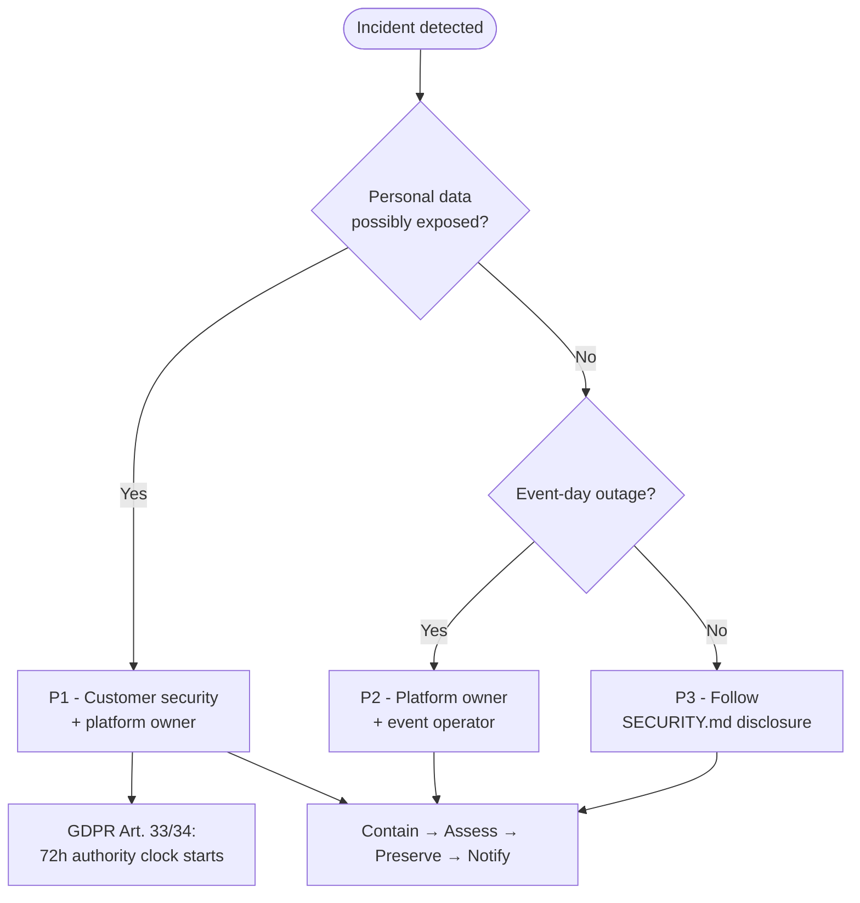

# Incident Response (One-Pager)

A template for security and availability incidents in a **self-hosted** Admitto deployment. Assign names and contacts in your internal runbook.

- [Triage](#triage)
- [Severity](#severity)
- [First 30 minutes](#first-30-minutes)
- [Secret rotation](#secret-rotation)
  - [Lost or stolen check-in tablet](#lost-or-stolen-check-in-tablet)
- [Rollback](#rollback)
- [Health checks](#health-checks)
- [Aftercare](#aftercare)
  - [Post-incident review](#post-incident-review)
- [Related documents](#related-documents)

---

## Triage



## Severity

| Level | Examples | Lead |
|-------|----------|------|
| **P1** | Suspected data breach, leaked production secrets | Customer security + platform owner |
| **P2** | Outage on event day, mail or database unavailable | Platform owner + event operator |
| **P3** | Vulnerability in Admitto or dependencies | Follow the [SECURITY.md](../../SECURITY.md) disclosure process |

---

## First 30 minutes

1. **Contain.** Rotate exposed secrets, disable compromised accounts, and block abusive traffic at the edge.
2. **Assess.** Look at the admin audit log, the readiness probe, the mail delivery log and recent deployments. Use the two log sources below.
   - **Security log** (Organisation settings → Logs → Security, superadmin only): a durable history of login, MFA, logout, OIDC and access-denied events. It survives a restart, so prefer it over the live tail to reconstruct what happened. Writes are best effort. A database hiccup at the moment of the event can leave a gap, even though the auth action itself succeeded. Rows past the retention window (30 days by default) are gone.
   - **System logs** live tail (Organisation settings → Logs → System, superadmin only): recent activity in near real time. It holds only the last 1000 entries, and only while the server process is still running.
3. **Preserve.** Snapshot the logs and the database if an investigation is likely.
4. **Notify.** Tell the privacy officer if personal data may be affected. Then, where GDPR applies:
   - **Art. 33:** notify the supervisory authority **without undue delay and, where feasible, within 72 hours** of becoming aware of a personal-data breach. The exception is a breach that is unlikely to result in a risk to individuals.
   - **Art. 34:** notify the affected data subjects when required.
   - Record the timeline, the scope and the decision in your internal breach register.

---

## Secret rotation

Treat any secret exposed in logs, tickets or version control as **compromised**.

| Secret type | Action |
|-------------|--------|
| Database password | Rotate it in the database and in the deployment config. Restart the services |
| Mail integration | Rotate it in M365 or the SMTP provider, and in the application settings |
| Encryption key | Major incident. Plan re-encryption with a maintenance window |
| Redis password | Change `REDIS_PASSWORD` and the password inside `REDIS_URL` together. Then recreate `redis`, `app` and `worker` |
| Wallet provider (PassCreator) API key | Rotate it at the provider. Then paste the new key in Event Settings → Wallet, for each event |
| SSO client secret | Rotate it at the identity provider. Then update the provider under Settings → Identity |
| Turnstile secret key | Rotate it in the Cloudflare dashboard, and make sure the old secret no longer works. Then save the new secret under Organisation Settings → External services → Guest registration. Until you do, forms that use a public link or a password cannot check guests and refuse them |
| Alert webhook URL | Regenerate it at Discord, Slack or the receiving service. Then update Organisation Settings → Notifications. The URL is itself a bearer-style secret |
| Emergency check-in token | Change `CHECKIN_OPERATOR_TOKEN` (or leave `ALLOW_CHECKIN_BEARER` unset). Recreate `app` |
| Monitoring token | Regenerate it and update your observability tools |
| Session compromise | Invalidate the active sessions and force staff to sign in again. For a lost or stolen check-in tablet, see below |

See [SECURITY.md](../../SECURITY.md) for the project secret policy.

### Lost or stolen check-in tablet

**Revoke its session straight away.** In **Users & roles**, open the user's active sessions.

Why it is urgent:

- An operator who signed in on the day of their event stays signed in, with no inactivity timeout, until 06:00 the next morning (or the event's end time, if that is later).
- Operator accounts have no second factor. A superadmin can add the `operator` role to the required-MFA list, but that is not the default.

Other options:

- A superadmin can turn off **Operators stay signed in on event day** in Settings → Security. That stops new such sessions and puts the normal two-hour inactivity limit back on existing ones at once. It does not shorten their end time, so a tablet that is still being used stays signed in until then.
- If the web UI is unreachable, revoke the sessions of one user from the command line:

  ```bash
  docker compose run --rm app node apps/cli/dist/index.js sessions revoke --user <email> --operator-email <superadmin email>
  ```

  Or revoke the sessions of every user:

  ```bash
  docker compose run --rm app node apps/cli/dist/index.js sessions purge --all --yes --operator-email <superadmin email>
  ```

---

## Rollback

| Situation | Action |
|-----------|--------|
| Bad application release, schema unchanged | Deploy the previous container image tag |
| Failed database migration | Restore the pre-upgrade or nightly backup. Redeploy the previous image |

Procedure detail: `deploy/README.md` (rollback runbook).

---

## Health checks

```bash
curl -fsS https://<your-host>/healthz
curl -fsS -H "Authorization: Bearer <readiness-token>" https://<your-host>/readyz
```

Readiness output is meant for operators. It contains no personal data.

---

## Aftercare

1. Find the root cause and the timeline. See **Post-incident review** below for how deep to go.
2. Update the runbook or the perimeter controls if needed.
3. Get privacy / DPO sign-off when personal data was involved. Include the decision about the 72-hour authority notification if GDPR applies.
4. Patch dependencies or deploy a hotfix release if applicable.

### Post-incident review

- **P1:** always write one. Circulate it to customer security and the platform owner within 5 business days.
- **P2:** always write one, less formally. A few paragraphs are enough. Circulate it to the platform owner and the event operator.
- **P3:** a review is optional. The [SECURITY.md](../../SECURITY.md) disclosure record usually covers it.

Keep it short and blameless: a paragraph per section, not a full report.

- **What happened:** a plain-language summary, who noticed it and how.
- **Timeline:** detection, containment and resolution, each with a timestamp.
- **Root cause:** the actual mechanism, not just "human error".
- **Impact:** what broke, for whom and for how long. Personal data involved, if any.
- **What we are changing:** the concrete follow-up (a runbook update, a new alert, a code fix) with an owner. If there is nothing to change, say why.

---

## Related documents

- [SECURITY.md](../../SECURITY.md)
- [SECURITY-CONTROLS.md](SECURITY-CONTROLS.md)
- [DATA-PROTECTION.md](../../DATA-PROTECTION.md)
- [CORPORATE-DEPLOYMENT.md](CORPORATE-DEPLOYMENT.md)
