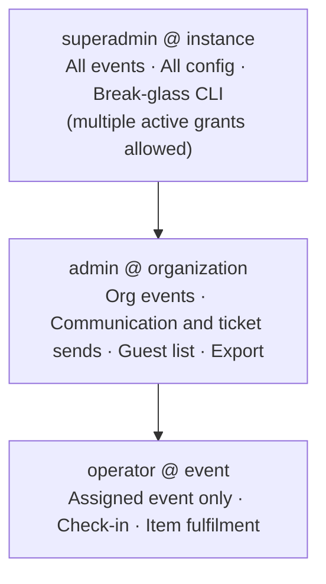

# Security Controls (Application)

This document describes **security capabilities** that Admitto supports in typical
self-hosted deployments. It is written for **privacy officers, security reviewers, and operators**
at mid-size and enterprise organizations.

For **repository CI** (SAST, secret scan, container scan, SBOM), see [SECURITY.md](../../SECURITY.md).
For **hosting and data residency**, see [CORPORATE-DEPLOYMENT.md](CORPORATE-DEPLOYMENT.md).

> **How to read this:** rows describe what organizations commonly require and how Admitto can be
> configured - not a checklist of what any single deployment must enable. Your runbook and
> environment variables define the effective control set.
>
> **`Where` column:** **App** = built into the application; **Config** = available but must be
> enabled or tuned in deployment settings; **Operator** = customer infrastructure or process
> (reverse proxy, disk encryption, perimeter, runbooks).

- [Control areas (summary)](#control-areas-summary)
- [Authentication and access](#authentication-and-access)
  - [Role hierarchy](#role-hierarchy)
  - [Sessions](#sessions)
  - [Passwords and sign-in protection](#passwords-and-sign-in-protection)
  - [Implemented in codebase](#implemented-in-codebase)
  - [SSO and two-factor authentication](#sso-and-two-factor-authentication)
- [Authorization (RBAC)](#authorization-rbac)
- [Legal texts of an event](#legal-texts-of-an-event)
- [Guest registration submit](#guest-registration-submit)
- [Address confirmation](#address-confirmation)
- [Optional hardening (customer choice)](#optional-hardening-customer-choice)
- [Rate limiting](#rate-limiting)
  - [Public and authentication](#public-and-authentication)
  - [Operations probes](#operations-probes)
  - [Staff admin (authenticated)](#staff-admin-authenticated)
  - [Superadmin (identity provider UI)](#superadmin-identity-provider-ui)
  - [Body size caps](#body-size-caps)
- [Reverse proxy and client IP (`TRUST_PROXY`)](#reverse-proxy-and-client-ip-trust_proxy)
- [Outbound HTTP (SSRF mitigation)](#outbound-http-ssrf-mitigation)
- [Data protection in operations](#data-protection-in-operations)
- [Known scope limits (MVP)](#known-scope-limits-mvp)
  - [Multiple instance superadmins](#multiple-instance-superadmins)
  - [Offboarding runbook for OIDC-managed elevated roles](#offboarding-runbook-for-oidc-managed-elevated-roles)
  - [Penetration test verification (operator checklist)](#penetration-test-verification-operator-checklist)
- [Related documents](#related-documents)

---

## Control areas (summary)

| Area | Typical enterprise expectation | Admitto support | Where |
|------|-------------------------------|-----------------|-------|
| Authentication | Staff sign-in before admin/operator actions | Local accounts and/or **OIDC** | App · Config |
| Authorization | Least privilege by role and event/org scope | **RBAC** (admin, operator, platform roles) | App |
| Strong auth | MFA for privileged users | **TOTP** authenticator apps, and **WebAuthn passkeys/security keys** for elevated roles (see the notes below the table) | App · Config |
| Edge access (ZTNA) | Restrict staff URLs at the perimeter, so an unauthorized request never reaches the application at all | Optional zero-trust network access (ZTNA) gateway in front of staff paths (see the notes below the table) | Operator |
| Session security | HttpOnly cookies, TLS, rotation | Configurable lifetime; server-side revocation | App · Config |
| CSRF | Protect state-changing browser requests | Same-origin checks on mutating requests (behind standard reverse proxy) | App |
| Abuse prevention | Rate limits on auth, public, ops, and admin surfaces | Per-route throttling (see **Rate limiting** below; shared Redis store, required in production) | App · Config |
| Browser hardening | Clickjacking, MIME sniffing, script injection, saved copies of API answers on a shared device | Baseline security headers, a Content-Security-Policy and `Cache-Control: no-store` on API answers (see the notes below the table) | App · Config |
| Outbound fetch safety | Block SSRF from OIDC / JWKS admin actions | Hostname blocklist + DNS resolve-before-connect on outbound HTTP | App |
| Secrets | No credentials in source code | Env / secret manager; integration secrets encrypted in DB | App · Operator |
| Data at rest | Protect tickets and integration secrets | Field-level encryption for sensitive data; **disk encryption** | App · Operator |
| Transport | TLS to users | Terminated at customer **reverse proxy, load balancer, or CDN** | Operator |
| Logging | Minimise personal data in logs | Redacted identifiers in audit output; no secrets in log lines; a superadmin-only live tail of recent activity (see **System logs** in [DATA-PROTECTION.md](../../DATA-PROTECTION.md)) | App |
| Supply chain | Scans on code and container image | Documented in [SECURITY.md](../../SECURITY.md) | App |

Notes on the rows above:

- **Strong auth.** WebAuthn means FIDO2 passkeys and security keys, for example Face ID, Windows Hello or YubiKey. They are usable for enrollment, sign-in and step-up. An SSO sign-in does not use them: the identity provider decides, see [SSO and two-factor authentication](#sso-and-two-factor-authentication).
- **Edge access (ZTNA).** For example **Cloudflare Access**. The gateway verifies identity (via the same OIDC provider or its own) and device posture before it proxies the request through. It complements, and does not replace, Admitto's own RBAC.
- **Browser hardening.** Baseline headers on responses: `X-Content-Type-Options: nosniff`, `X-Frame-Options: DENY`, `Referrer-Policy: same-origin`, HSTS with `includeSubDomains`, and `X-Robots-Tag: noindex, nofollow`. The staff SPA and the auth pages also get a route-specific Content-Security-Policy, with extra trusted origins configurable by a superadmin (Settings → Security). The public registration page gets its own policy: scripts only with a per-response nonce (no `unsafe-inline`), `connect-src` and `form-action` limited to the page's own origin, `Referrer-Policy: same-origin`, `Cache-Control: no-store`, and Cloudflare Turnstile allowed in `script-src` and `frame-src` only when the instance has Turnstile keys. That policy ignores the configurable trusted origins, so a superadmin cannot widen the trust of a page that collects personal data. The not-found answer for an unknown link and for a closed event is the same page, with no branding loaded.
- **API answers are not stored.** Every answer the application sends under `/api/` carries `Cache-Control: no-store`, so browsers and proxies are told not to keep a copy. This matters on shared devices such as check-in tablets. The live check-in stream is the one exception and sends `no-cache`.

---

## Authentication and access

### Role hierarchy

**Staff surfaces** (administration, check-in) require authentication. Deployments may use:

- **Local accounts** with password and mandatory MFA for admin and superadmin (by default).
- **OIDC / SSO** (optional) alongside a local break-glass administrator account.
- **Perimeter access control** (optional) - e.g. corporate zero-trust gateway, VPN, or CDN access
  rules in front of staff URLs. This complements, but does not replace, application RBAC.

### Sessions

Sessions are **server-side**: the cookie holds an opaque token, and only its hash is stored in the database. Cookie flags follow common web hardening (`httpOnly`, `SameSite`, `secure` in production).

**Cleanup.**

- Expired or revoked session and trusted-device rows are purged best-effort on the Admitto **worker** (at boot and about every 24 hours).
- Operators can also run `docker compose exec app node packages/auth/dist/cli.js purge-auth-retention --dry-run` to preview counts. Drop `--dry-run` to run it.
- The production image ships no `npm`.

#### Trusted devices after sign-out

Signing out (`POST /api/auth/logout` from the staff app, or `POST /logout` from the server-rendered pages) revokes the session. It intentionally does **not** clear the `admitto_trusted_device` cookie or its database row.

So a **"Remember this device"** trust lasts for its full window (`trusted_device_days`, 30 days by default), however many times the user signs out and back in on that browser. It is cleared only by one of:

- the trust window expiring,
- a password change,
- an MFA reset,
- an admin-initiated reset, or
- the account's own **"Forget all trusted devices"** action (My account → Two-factor authentication's options menu).

> **Shared check-in devices.** On shared operator tablets, signing out alone does not clear remembered-device trust.
>
> - The trust is scoped to that specific account (`validateTrustedDevice` rejects the cookie for a different `user_id`), so it does not carry over to whoever uses the device next.
> - It does, however, let the *same* account skip MFA again on that device until the trust window expires.
>
> Mitigations for an instance where the same account may sign in from a device it shouldn't stay trusted on:
>
> - Set `trusted_device_days` to a short value, or `0` to disable the feature entirely.
> - Use **"Forget all trusted devices"** or an admin-initiated reset to clear trust sooner.

#### Session idle timeout

A `full`-stage session ends once `now - last_seen_at` exceeds a configurable idle window, as well as at its absolute lifetime. This limits how long a stolen or left-open admin browser tab stays authenticated. The idle window uses the same env-lock pattern as the absolute-lifetime settings.

| Role | Idle timeout env var | Idle default | Absolute default |
|------|----------------------|---------------|-------------------|
| Admin | `SESSION_IDLE_TIMEOUT_ADMIN_MS` | 30 min | 12h |
| Operator | `SESSION_IDLE_TIMEOUT_OPERATOR_MS` | 2h | 12h |

- Settings → Security warns inline when either an absolute lifetime or an idle timeout is set past a sane threshold.
- The API rejects a save where the idle timeout would exceed that role's own absolute lifetime.

**The admin absolute lifetime.**

- The 12h admin default only applies while no `session_ttl` row exists. A value stored in Settings → Security is kept as it is.
- An instance that wants a different lifetime, for example 7 days, sets it in Settings → Security.

#### Operator event-day session

An exception to the table above, for check-in tablets that sit idle between shifts and are handed to staff who are not expected to make security choices.

**Who gets it, and what they get.**

- An operator-only account (no Admin or Superadmin role in any scope) that signs in, by any method (password, passkey or SSO), on the day of a non-archived event it is assigned to.
- One session with **no inactivity window**. It ends at the later of 06:00 the next local morning and the event's own end time.
- The session cookie is persistent, so it survives the tablet app being closed.
- Nothing is ticked or chosen at sign-in.

**What counts as the day.**

- The event's calendar day (`Event.date`, read as its UTC calendar day), from local midnight to the next local midnight in the event's own timezone.
- It is converted from wall-clock time, so a 23 or 25 hour daylight-saving day still runs midnight to midnight.
- For an overnight event (end time earlier than start time), a sign-in still counts until the event ends the next morning.
- Only the moment of sign-in counts: someone who signs in the evening before gets a normal session and has to sign in again on the day.
- A date or timezone that cannot be read means normal limits, never a longer session.
- An event has one date, so an event lasting several days needs one event per day to be covered on each.

**When it is decided again.**

- When a partial session is promoted to full (MFA, forced password change).
- The role and the master switch are re-read on every request. So an Admin role granted after sign-in, or the switch turned off mid-event, puts the normal inactivity window back at once.
- The end time itself is not shortened, and a role change does not clamp it to the admin lifetime.

**What does not shorten it.**

- Like every session lifetime here, the expiry is fixed when the session is issued.
- Removing the assignment, moving the event date or archiving the event does not shorten a session already issued (per-request authorization still blocks that event).
- Revoke it from **Active sessions** if that matters.

**The master switch.**

- It is the `operator_event_day_sessions` system setting (`OPERATOR_EVENT_DAY_SESSIONS`), on by default.
- A value that is set but is not a boolean turns it off rather than leaving it on. That covers an environment value other than true, false, 1 or 0, and a hand-edited row.

**Why this is acceptable.** OWASP ASVS 7.1.1 asks for a documented, risk-based decision. The guidance considered:

- NIST SP 800-63B-4 allows up to 30 days at AAL1 (password only) with an optional inactivity timeout, and 24 hours with a 1 hour inactivity timeout at AAL2. It recommends that "remember me" style persistence be limited.
- This exception stays within the AAL1 bound. It ends at most about 30 hours after sign-in (sooner for most sign-ins; later only when an overnight event itself ends after 06:00).
- Admin and Superadmin limits are unchanged.

**Accepted risk.** Operator accounts have no MFA by design (a superadmin can add the `operator` role to the required-MFA list in Settings → Security). So a lost or stolen tablet that is signed in on event day stays signed in until the end of that day or until someone revokes the session.

### Passwords and sign-in protection

#### Password blocklist

- It applies to every place a password is set or changed: first-run setup, forced change, self-service Account change, and admin-initiated create/reset.
- A password needs at least 12 characters, and it is rejected if it is on a built-in list of 143 very common passwords.
- A password with very few different characters is rejected, such as `aaaaaaaaaaaa` or `ababababab`. "Very few" means the number of different characters is at most a quarter of the password's length and at most 6. A 12-character password therefore needs at least 4 different characters, and a long generated password such as 64 hex characters or two UUIDs is accepted.
- A simple ascending or descending run of six or more characters is rejected too, such as `abcdefghijkl`.
- It is enforced server-side, not just by the strength meter shown while typing.
- The basis is NIST SP 800-63B-4 §3.1.1.2, which requires checking candidates against a blocklist instead of relying on character-composition rules.

#### No account lockout, by design

Local password authentication never locks or disables an account after repeated failed attempts. A login-triggerable lockout on admin/superadmin accounts would itself be a denial-of-service vector on a self-hosted internal tool.

#### The per-email sign-in limit is a temporary block

- Password sign-in accepts 10 attempts a minute for one e-mail address, from any client address.
- Every attempt is counted before the password is checked (see **Rate limiting**).
- After 10 attempts, even the account owner is refused with "Too many requests" until the minute is over.
- Anyone who knows an address can use up that allowance, and can repeat it.
- It applies to password sign-in only (`POST /login` and `POST /api/auth/login`). Passkey sign-in and SSO use other limits, per client address, so they stay available.

#### Brute-force protection and alerts

Brute force is mitigated instead by:

- The login rate limits (see **Rate limiting**).
- An audit record on repeated failed attempts against privileged accounts (`packages/auth/src/privileged-login-alert.ts`). Crossing the threshold emits an `auth.login.repeated_failures` (or `auth.mfa.repeated_failures`) event into the System logs live tail and writes a durable `SecurityAuditLog` row, for an operator to find on review. This record never blocks the account.

**Security alerts** (Organisation Settings → Notifications):

- Repeated failed sign-ins on an admin or superadmin account also raise a security alert: an in-app notification and an email to the organisation's admins, plus the organisation's optional Discord, Slack or generic-JSON webhook.
- Each of these channels can be switched on or off separately for each alert type (all on by default).
- The same mechanism alerts on emergency two-factor bypass use, login or security settings changes, an admin sign-in from a new country and an admin or superadmin role being granted.
- It also sends mandatory self-alerts to the account owner: a password or two-factor change, a sign-in from a new location, and a reused two-factor code.
- Repeated failed MFA codes (`auth.mfa.repeated_failures`) are audit-only and send no notification.

### Implemented in codebase

These capabilities exist in the application - they are **not** roadmap-only claims:

| Capability | Where |
|------------|-------|
| TOTP MFA (privileged roles) | `packages/auth` - MFA enrollment and verification |
| WebAuthn passkeys / security keys (enrollment, sign-in, step-up) | `packages/auth/src/mfa/webauthn.ts`; `apps/web/src/auth/mfa-html-routes.ts`, `apps/web/src/admin/account-routes.ts` |
| OIDC / SSO | `packages/auth` OIDC provider module; staff login routes in the web app |
| Local break-glass admin | Local account provider alongside OIDC |
| Emergency check-in bearer token | Off by default (break-glass). `ALLOW_CHECKIN_BEARER=true` plus a `CHECKIN_OPERATOR_TOKEN` of at least 32 characters re-enables a shared bearer token for the check-in scan/lookup API only. Rate limits are keyed per IP instead of per user |

Effective controls still depend on **customer configuration** (OIDC is disabled by default).

- Two-factor authentication is required by default for the `admin` and `superadmin` roles (`MFA_REQUIRED_ROLES`, default `admin,superadmin`). A superadmin can change the list in Settings → Security unless the environment variable locks it.
- Those users must enrol TOTP or a passkey/security key at first sign-in.
- Operator accounts have no second factor by default, because a check-in station must stay usable on event day. The `operator` role can be added to the required-role list in Settings → Security.
- Confirm your deployment runbook matches your security policy.

### SSO and two-factor authentication

An SSO sign-in is a full session straight away. Admitto does not ask for a second factor of its own after it.

| | Local password sign-in | SSO sign-in |
|---|---|---|
| Second factor asked by Admitto for admin and superadmin | Yes, by default (`MFA_REQUIRED_ROLES`) | No |
| Who decides whether a second factor is used | Admitto | Your identity provider |

- Admitto validates the ID token and reads the subject plus the claims mapped in the provider settings (email, name, groups and phone number).
- It does **not** read `acr`, `amr`, `auth_time` or `email_verified`. So Admitto cannot tell whether the identity provider asked for a second factor.
- Whether administrators who sign in with SSO use one is enforced only by the identity provider, for example by a policy there.

---

## Authorization (RBAC)

Roles are scoped to **instance**, **organization**, or **event** as appropriate:

| Role | Typical use |
|------|-------------|
| `superadmin` (instance) | System configuration, integrations, user management, break-glass |
| `admin` (organization) | Import, mail, exports, event configuration |
| `operator` (event) | Event-day scanning and lookup only |

Access checks are enforced on API routes and staff UI entry points.

---

## Legal texts of an event

An event can carry its own privacy notice, event terms and extra consents. An event admin writes them and anonymous guests read them on public pages, so the whole path treats them as content from a signed-in user that is shown to strangers.

| Control | What it does |
|---------|--------------|
| Access | `/api/admin/events/:eventId/legal-documents` needs an admin of the event's organisation or a superadmin, checked on the server. An operator gets 403, and so does an admin of another organisation. Writes are refused for an archived event. |
| Sanitiser | The HTML is cleaned once, on save, with an allowlist ([`sanitize-legal-html.ts`](../../apps/web/src/legal/sanitize-legal-html.ts), built on `sanitize-html`): paragraphs, headings h2 to h4, bold, italic, lists, quotes, rules and links. There is no `style`, `class`, `id`, event handler, image, table, form or frame. A link must be an absolute http, https or mailto URL without a user name or password; any other link becomes plain text. Only the cleaned HTML is stored and served. Cleaning is repeated until the result stops changing; a text that has not settled after four passes is refused (422 `legal_document_unsupported`). |
| Page headers | `GET /legal/<event slug>/<text>` has the zero-script headers of the ticket page: `script-src 'none'`, `connect-src 'none'`, `form-action 'none'`, `frame-ancestors 'none'`, `Cache-Control: no-store`, `Referrer-Policy: no-referrer` and `noindex`. It reads and sets no cookie. This is the second layer behind the sanitiser. |
| One 404 | An event that does not exist, a text that does not exist, a draft and a malformed address all get the same 404, byte for byte, as the registration form's not-found page. A draft cannot be previewed at its public address, not even by a signed-in admin. |
| Limits | A title of up to 200 characters, a text of up to 100 000 characters, a request body of up to 512 KB, and up to 10 extra consents per event. |
| Audit | Saving, publishing, withdrawing and deleting a text write an entry to the audit log (event, kind and key). The text is never written there. |
| Reach | A published text is served whatever the event's registration setting is, and for an archived event too, so a guest can read again what they were told and accepted. A draft is never served. |
| Tabs | When an event has two or more published texts, each page shows tabs to the others (title and link only, read in the same query as the text). A draft and the texts of another event never appear, and a page with a single text has no tabs. |
| Gate | The registration settings, which come in a later change, must call the gate in the transaction that turns registration on: it answers 409 `legal_documents_missing` until the privacy notice, the terms and every extra consent the event asks for are published. Already today, a text that registration needs cannot be withdrawn or deleted while registration is on (409 `legal_document_in_use`). The gate and the withdrawal take one lock per event, so they cannot interleave. |
| Rate limit | The pages share the per-IP bucket of the registration form's page (300 / 60 s, see [Public and authentication](#public-and-authentication)). |

A legal text holds no guest data and has no per-guest copy: a registration records only when its terms were accepted, not which text. What the text says about the organisation is what the organisation wrote. It is deleted with its event.

---

## Guest registration submit

`POST /r/:slug` is the one anonymous route that writes a guest's personal data, so everything on it is built to give a stranger nothing and to cost the system little. It is the page's own endpoint, not an API for other programs: the body is the contract in [`form-contract.ts`](../../apps/web/src/registration/form-contract.ts), which can change.

| Control | What it does |
|---------|--------------|
| Order of checks | Each step is cheaper than the one after it: the cross-site check, the per-IP limit and the 64 KB cap (before the handler); the content type (415) and the shape of the body (400); the event; the bot challenge; the per-event ceiling; the event once more (the challenge is a call over the network, and the form may have been closed or changed meanwhile: a form that is not open now is the same 404, an event that ended meanwhile included, as the clock is read again there and once more at the write under the locks, and the fields are judged by what it asks now); for an event whose way in is the password, the tries at it are counted and the password is checked (see below); the fields (422); and only then the database is written. |
| One 404 | An unknown slug, registration off, an archived event, an event that is over, and a form that is not ready (a legal text not published, no Turnstile keys, another way in, a password that is not set for an event whose way in is the password) all answer the one 404 of the registration routes, byte for byte, as the form's page does. The route looks the event up with the page's own code, so a request tells a stranger no more than the page does. |
| Bot challenge | The Turnstile token is checked with Cloudflare on every request, bound to the event and to the instance's host. It works once. A refused token is a 400 with one sentence for every reason; a check that cannot be made is a 503. Nothing is written before it passes. |
| Event password | An event whose way in is the password has one password for everybody who is invited (D-C3). The organiser sets it, changes it and switches it off, and only an argon2id hash is stored: the password is never kept as typed. A guest types it on the first screen of the page, and the page sends it with the form. It is checked once, after the bot challenge and before anything that depends on the address or on a field. A password that is wrong, missing, not a text or longer than 128 characters is the one `403 {"error":"access_denied"}`, byte for byte, whatever the address is (new, known, an attendee's, not even an address) and whichever way it is wrong; a try that cannot be the password (missing, not a text, too long) costs no hash. The answer waits for the same floor as every other answer, counted from before the hash, so the work of the check is inside it. An event whose way in is the link ignores a password it is sent, with no error and no line in a log. An event whose way in is the password and that has none is the one 404. |
| After the right password | The guest is told what any guest is told: the same `200 {"ok":true}` for a new address and for a known one, with the same headers and after the same floor, since one password is known to a whole group and an answer that said "you are already registered" would let any of them ask who is on the list (Q9). A new address gets a registration that waits for its address, like the link (D-C5). |
| No session, no check route | There is no cookie, no session and no route that only checks the password: it travels in the one `POST` of the form. The page's own screen only looks that something is typed, so the questions of the form are in the page for anyone who knows its address. The password protects the registration, not the page. |
| Tries at the password | Every try that reaches the check is counted, the right ones too, in two budgets: 30 in 15 minutes for the client (an IPv6 client by its /64: the people of one company sit behind one address), then 120 a minute for the event (each try is a hash). Both come after the bot challenge, so a bot with no token spends nothing of the budget of a company behind one address, and the client's budget comes first, so a client that is out of tries cannot spend the event's. A spent budget is `429`, as the event's ceiling is. It writes one `registration_password_tries_refused` warning to the system log, at most one an hour for an event and a budget in a process, with the id of the event and which budget, and never the address of the client, an address of a guest or a password. |
| Setting the password (staff) | `PUT` and `DELETE /api/admin/events/:eventId/registration/password` need an admin of the event's organisation or a superadmin, checked on the server (an operator gets 403, and so does an admin of another organisation), the cross-site check, and an event that is not archived. The body is `{"password": "..."}`, at most 4 KB, 8 to 128 characters, taken as typed with no other rule. Both answer `204` with no body: the password is written and never read back, and the hash is in no answer. The audit entry `registration_password_changed` says whether the password was set or switched off, for which event and by whom, and holds nothing of the password. Changing or switching it off touches no registration and no confirmation link that is still valid. |
| One answer | A new address, an address with a registration in any state, an attendee's address in any status, and a registration whose mail was withheld all get `200 {"ok":true}` with the same headers and the same bytes. A new submission never changes a registration that exists. |
| Time floor | Each of those answers waits until 250 ms have passed since the challenge was checked, so the extra work of storing a new registration does not show in the time. So does the answer to two requests for one address that race each other and meet the database's refusal of a second row. The wait holds no database connection. The figure is a first value, to be measured under load in the review of the release. |
| Fixed sentences | A refused field gets a sentence from a fixed set, chosen by the field and the kind of answer. Nothing a guest typed and no text of an exception is sent back. |
| Terms and consents | The terms must be accepted (422 under the terms otherwise). The time of the acceptance and of each extra consent that was ticked is stored. Only consents of this event's published texts are accepted; any other key is a 400. |
| Lock held | An import holds the event's capacity lock while it runs. The route only tries for the lock. After about two seconds it answers `503 {"error":"try_again"}` with `Retry-After: 5` and nothing written, the same for every address. At most three submissions per process try at once, so the connection pool stays free for staff. |
| Mail budgets | The mail of a new registration is withheld, and the registration is stored, when its address has had 3 mails in 24 h across the instance or when the event has used its budget (see [Public and authentication](#public-and-authentication)). The answer does not change. A spent event budget writes one `registration_mail_withheld` warning an hour per event to the system log, with the event id and nothing else. |
| Send again | A form sent again for an address whose registration still waits for its confirmation queues the same link once more: the row of the confirmation mail is put back in the queue, so the link is the same and it expires when it did. It happens at most once in 10 minutes for a registration, under the address's budget, the event's budget of mail rows, and the event's budget of resends (the rows do not grow with a resend, so it has a count of its own: the same cap, kept in the rate-limit store). What the second submission typed is not stored. The answer, the headers and the time are those of every other address. |
| Logs | Nothing that identifies a guest is logged, and no password or hash. An unexpected failure logs the class of the error, its database error code and the route name, and the guest gets `500 {"error":"internal_error"}`. |

The answers that do not depend on the address may differ: the form is closed (404) or full (409 `full`), the challenge or a field is refused (400, 422), the password is refused (403 `access_denied`), a limit is spent (429), a lock is held (503). One residual is accepted until the release review measures it: under heavy load the work of a new address can outlast the floor.

---

## Address confirmation

A guest who registers by the public link gets a mail with a link, and the registration waits for the click (24 hours). `GET` and `POST /r/:slug/confirm/:token` are the two routes behind that link. They are anonymous, and the link is the only proof they have, so everything rests on the signature in it.

| Control | What it does |
|---------|--------------|
| The link | `/r/<event slug>/confirm/<registration id>.<signature>`. The signature is an HMAC of the registration id, made with the instance key under a prefix of its own, and nothing is stored. It is compared in constant time. The link for a registration is always the same, so a mail that is sent again carries it unchanged. |
| A bad token | A token that is not shaped like one, or whose signature does not match, answers the one 404 of the registration routes, byte for byte, before anything is read from the database. The same 404 answers an unknown event, registration off and an archived event. A stranger who guesses links learns nothing. |
| Opening does not confirm | `GET` (and `HEAD`) shows a page with a button and changes nothing. Mail scanners, link previews and prefetching browsers open the links of a message, so opening cannot be what confirms. The page says nothing about the registration, and is the same page for a registration that exists and for one that does not. |
| The button | `POST` confirms. It is a plain form that posts to the page's own address, with no script on the page. It has the cross-site check, the per-IP limit (`registration:confirm`, shared with the page) and a 1 KB cap on a body that is never read. |
| What the answer says | The link is the proof of the address, so the answer says where the registration stands: registered, waiting for the organisers, on the waiting list, already confirmed, expired, already registered as an attendee, event full, or try again. It holds no name, address or answer of the guest. A registration that the organisers turned down is told as "already confirmed", as a rejection is not told when the organisers chose not to send the mail. |
| Expiry | The link works until `confirm_expires_at`, 24 hours after the registration. The service judges it by the clock read after both locks are held, on every try, so a link that runs out while the request waits is expired. A link that ran out and a registration that was deleted answer alike: which it is depends on when the clean-up last ran. |
| What closes it | Registration off, an archived event or an unknown event: the 404. An event that is over: the closed page. The way in, the bot check keys, the texts and the questions of the form do not close it: a guest who holds a link is not turned away because they changed meanwhile. |
| Locks | The same as a submission: the capacity lock and the registration queue, taken by trying. A held lock (an import, an erasure) ends the transaction with nothing written and, after about two seconds, answers `503` with `Retry-After: 5` and a page with a button to try again. The link stays valid. |
| Twice | A second click, or several at once, finds the registration placed and says so: one attendee, one ticket mail, no error. |
| Erased | An erasure deletes the registration, so its link finds nothing. An erasure that is still running holds the queue, and the confirmation does not go ahead. |
| Logs | The access log holds `/r/<event slug>/confirm/[redacted]` and a short hash that tells two requests for one link apart from other links. A failure logs the class of the error only. |

Two things are different from the submit route, on purpose. There is no floor of time on the answers: only the holder of a valid link reaches the database, and what they are told is about their own registration. And the form's own conditions do not apply, as the row "What closes it" says.

**What stays outside Admitto.** A reverse proxy or a CDN in front of the app logs the full path, and so holds the link for as long as it keeps its access log. The link is worth 24 hours at most, and only until it is used. Redact the path of `/r/*/confirm/*` in those logs, or keep them short. The mail provider's Sent Items holds the mail with the link, as it holds any other mail.

---

## Optional hardening (customer choice)

Organizations with stricter policies often add controls **outside** the application:

| Layer | Examples (customer infrastructure) |
|-------|-------------------------------------|
| Edge / CDN | Cloudflare, Akamai, corporate CDN with WAF |
| Reverse proxy | nginx, **Nginx Proxy Manager**, HAProxy, F5, cloud load balancer |
| Network / ZTNA | Site-to-site VPN, private link to origin, or a zero-trust access gateway (see the first note below) |
| Identity (SSO) | Entra ID, Okta, Authentik, or another OIDC provider (Organisation Settings → Identity; see the second note below) |
| Mail | Microsoft 365 / Graph, corporate SMTP relay |
| Container runtime | A read-only root filesystem, no extra Linux capabilities and `no-new-privileges` on the `app` container (see the third note below) |

- **Cloudflare Access is natively supported** (Organisation Settings → Identity). Admitto validates its JWT directly, so staff can authenticate through the gateway without a separate Admitto login prompt.
- **SSO.** Staff sign in with their existing corporate account instead of a separate Admitto password, with IdP group membership mapped to Admitto roles.
- **Container hardening** is optional and not in the shipped compose file, and only part of it was tried: see [Optional container hardening](../../deploy/README.md#optional-container-hardening).

Admitto is designed to sit **behind** a trusted reverse proxy (`TRUST_PROXY` and forwarded headers
documented in [`deploy/README.md`](../../deploy/README.md)). The proxy must **overwrite**
`X-Forwarded-For` with the real client IP - never append to a browser-supplied value.

---

## Rate limiting

Application throttles use a fixed window (default **60 seconds** unless noted).

- Each bucket resets at a fixed boundary rather than rolling continuously. So a burst straddling a window edge can allow up to roughly 2x the stated limit in the worst case. This is a common, accepted trade-off against the extra cost of a true sliding window.
- Limits apply per bucket key. When one is exceeded, the answer is HTTP **429**.
- Structured audit event: `auth.rate_limit.exceeded` (see `packages/auth` audit helpers).

**Store: Redis.**

- `REDIS_URL` (with a password of at least 16 characters) is required outside development and test. The application refuses to boot without it, so limits are shared across replicas and survive restarts.
- Only development and test runs fall back to an in-memory store per process.
- If Redis becomes unreachable while running, the store falls back to an in-memory limiter per process and logs a warning. Limits keep being enforced (per process, not shared); no route fails open or closed on this.

**Retuning limits.**

- Every limit below can be changed with the `RATE_LIMIT_OVERRIDES` environment variable: JSON keyed by limit name, for example `{"auth:login-ip":{"max":60}}` (see `deploy/ENV.md`).
- It is read at startup, so a change needs the container recreated, not a new release.
- The per-IP limits (sign-in, OIDC, passkey sign-in, account) are the ones to raise when many staff share one network address, such as venue Wi-Fi or a corporate NAT.
- The per-account protections (sign-in per email, MFA and password re-check buckets) are the real brute-force defence and should be loosened with care.
- The check-in stream has its own `CHECKIN_STREAM_*` variables instead.

**Why the per-IP limits are permissive.**

- Admitto's per-IP limits (30 sign-in, 30 passkey, 60 OIDC per minute) are permissive on purpose. A venue's staff share one address, and the real brute-force defence is the per-account counters.
- That follows the published guidance:
  - The OWASP Authentication Cheat Sheet says to count failures per account, not per IP, and warns that a lockout can be abused to lock others out.
  - NIST SP 800-63B allows at most 100 consecutive failed attempts per account, which is an upper bound, not a target.
- Stream reconnects follow the usual client practice of exponential backoff with a 30 s ceiling. The request budgets are far above what that schedule can produce.

### Public and authentication

| Surface | Bucket | Limit / window | Auth required |
|---------|--------|----------------|---------------|
| `POST /login`, `POST /api/auth/login` | client IP | 30 / 60 s | no |
| same | normalized email | 10 / 60 s | no (see the first note) |
| `POST /api/auth/mfa/verify`, `POST /mfa/verify`, TOTP confirm | session + IP; at sign-in also the account | 10 / 15 min per proof type (see the second note) | partial session |
| `POST /api/auth/mfa/webauthn/verify` (WebAuthn login-time step) | session + IP | 10 / 15 min | partial session |
| `POST /api/auth/mfa/totp/enroll`, `POST /mfa/enroll/start` | session + IP | 10 / 15 min | partial session (`enrollment_required`) |
| `GET /api/auth/oidc/*/start`, `*/callback` | client IP | 60 / 60 s | no |
| `POST /api/auth/login/webauthn/begin`, `POST /api/auth/login/webauthn/finish` (passkey sign-in) | client IP, one bucket each | 30 / 60 s | no |
| all `/api/account/*` routes except the notification unread-count poll (see the third note) | client IP | 30 / 60 s | no (checked before the session) |
| `/t/*` (ticket), `/q/*` (QR image), `/m/*` (event static map image) | client IP | 500 / 60 s | no |
| `POST /api/wallet/webhook/passcreator/:eventId` (+ `/voided`, `/first-confirmed`) | event; client IP | 120 / 60 s per event; 600 / 60 s per IP | no session (PassCreator signature required) |
| `GET /r/:slug` (public registration form) | client IP | 300 / 60 s | no |
| `GET /legal/:eventSlug/:text` (legal text of an event) | client IP, the same bucket as the registration form's page | 300 / 60 s | no |
| `POST /r/:slug` (registration submit) | client IP; then event, after the bot challenge | 120 / 60 s; 600 / 60 s per event | no |
| `GET`/`POST /r/:slug/confirm/:token` (address confirmation) | client IP | 120 / 60 s | no |
| registration password check (`POST /r/:slug`, after the bot challenge) | client IP; then event, by id | 30 / 15 min; 120 / 60 s per event | no |
| registration mail to one address | address (keyed hash), whole instance | 3 / 24 h | no |
| registration mail of one event | event, counted in the database | 1000 / 24 h, or 3 per seat if that is more | no |

Notes on the rows above:

- **Per-email sign-in limit.** It runs inside the handler. Every attempt is counted before the password is checked, so a correct password is refused too once the budget is spent.
- **MFA verification.** TOTP-shaped and recovery-code-shaped attempts are tracked on separate buckets, so the combined ceiling across both is up to 20 / 15 min. At sign-in the account also has one counter per user, across all sessions and addresses.
- **Account routes.** The notification unread-count poll has its own per-user bucket, 20 / 60 s.
- **Registration limits.** The `registration:page`, `registration:submit`, `registration:confirm` and `registration:password` policies, and the inline `registration:event`, `registration:mail-recipient` and `registration:mail-event` limits, exist before the routes that use them. `registration:page` is in use on the form's page (`GET /r/:slug`) and on the legal text pages. `POST /r/:slug` uses `registration:submit`, `registration:event`, `registration:mail-recipient` and `registration:mail-event` (see [Guest registration submit](#guest-registration-submit)). `registration:confirm` is used by the two routes of the [address confirmation](#address-confirmation). `registration:password` and the inline `registration:password-event` are the two budgets of the tries at an event password, which `POST /r/:slug` spends after the bot challenge, for an event whose way in is the password (see [Guest registration submit](#guest-registration-submit)).
  - **Per IP, generous on purpose.** The audience is staff of one company, often behind one NAT, so the per-IP numbers are high (compare `/t`, 500 / 60 s) and an IPv6 client is keyed by its /64 network. The bot challenge and the per-address mail limit are the real brakes. Raise or lower them with `RATE_LIMIT_OVERRIDES`, for example `{"registration:submit":{"max":30}}`.
  - **No slug in any key.** The slug is a caller-chosen path segment, so a bucket per slug would let anyone starve an event and create unbounded keys. The per-event ceiling (`registration:event`) is keyed by event id and is counted only after the bot challenge has passed and the event is found.
  - **Quiet when exceeded.** Page, submit, confirm and password do not write an `auth.rate_limit.exceeded` entry, because anyone can trigger them and would flush the 1000-entry system-log buffer, and that entry carries the address of the client. A spent budget of the tries at an event password is worth a trace, so the route writes one line of its own, at most one an hour for an event and a budget, with the id of the event and nothing of the client or the guest.
  - **Mail per address.** Counts only the queueing of a registration mail; the registrant gets the same answer either way. The budget is spent by a mail that is queued, not by a request: an address that has a place already, a full event, a refused form and a request told to try again spend nothing. The address enters the store only as a keyed hash, with a prefix of its own, so it never matches the test-send tag of the same address.
  - **Mail per event.** `registration:mail-event` is the base of a count of the event's mail rows queued in the last `windowMs` (24 h) for registrations created in that time, made in PostgreSQL under the registration queue, so a restart does not reset it and guests who submit at once cannot get past it. The mail that staff queue by deciding on an older registration is not counted. The cap is the larger of the base and three per seat of the event. A confirmation link sent again adds no row, so the resends of an event are counted apart, with the same cap and window, in the rate-limit store (a restart of a replica resets its share, and with Redis down the limit applies per process). Retune the base with `RATE_LIMIT_OVERRIDES`, for example `{"registration:mail-event":{"max":3000}}`: it moves both.
  - **Redis unreachable.** The limits keep applying per process and a warning is logged (see **Store: Redis**). They neither fail open nor fail closed. With several app replicas the effective limit is multiplied by their number until Redis is back.

### Check-in live updates (SSE stream)

`GET /api/checkin/events/:eventId/stream` is one long-lived connection per open Check-in, Overview or Reports page.

- An archived event opens none: its pages do not open the stream, and its requests are refused.
- Connects and reconnects are limited per operator per event and per operator overall.
- The number of simultaneously open streams is capped per application process.
- The defaults below are read once at startup from the `CHECKIN_STREAM_*` environment variables (see `deploy/ENV.md`). A value that is not a positive whole number is ignored, the default is used, and a warning is logged at boot.
- Changing them needs the container recreated, not just restarted.

| Bucket | Default | Variable |
|--------|---------|----------|
| connects and reconnects, per operator per event | 120 per window | `CHECKIN_STREAM_RATE_LIMIT_PER_EVENT` |
| connects and reconnects, per operator across events | 240 per window | `CHECKIN_STREAM_RATE_LIMIT_PER_ACTOR` |
| window | 60 s | `CHECKIN_STREAM_RATE_LIMIT_WINDOW_MS` |
| open streams, per operator per event, per application process | 6 | `CHECKIN_STREAM_MAX_CONCURRENT_PER_EVENT` |
| open streams, per operator overall, per application process | 12 | `CHECKIN_STREAM_MAX_CONCURRENT_PER_ACTOR` |

- The connect and reconnect limits use the shared rate-limit store.
- The open-stream caps are counted in the memory of each application process, not in a shared store. So with several application replicas the effective ceiling is the figure above multiplied by the number of replicas (for example 12 and 24 with two).
- When the rate limit is hit, the check-in page shows "Live updates paused briefly (too many reconnects)" and retries after about a minute. Scanning itself is not affected.

### Operations probes

| Surface | Bucket | Limit / window | Auth |
|---------|--------|----------------|------|
| `GET /healthz` | replica + client IP | 120 / 60 s | none (liveness; runs `SELECT 1`) |
| `GET /readyz` | client IP | 10 / 60 s | `OPS_HEALTH_TOKEN` (disabled when unset) |
| `POST /api/ops/system-logs` (worker to app log bridge) | client IP | 120 / 60 s | `OPS_HEALTH_TOKEN` |

- Docker `HEALTHCHECK` uses `/healthz` only.
- With shared Redis, the limit is scoped per process (`hostname`), so replica probes are not summed into one bucket.
- External monitors receive 429 only above 120 requests per minute per source IP (per replica). A poll every 10-30 seconds is well within the limit.

### Staff admin (authenticated)

| Surface | Bucket | Limit / window | Role |
|---------|--------|----------------|------|
| `POST …/import/preview` | user + event | 10 / 60 s | event admin |
| `POST …/import/commit` | user + event | 5 / 60 s | event admin |
| `POST …/template/preview`, `…/templates/:id/preview`, `…/system-templates/:name/preview` | user + event | 20 / 60 s | event admin |
| `POST …/template/test-send`, `…/templates/:id/test-send`, `…/system-templates/:name/test-send` | user + event | 5 / 60 s burst, 20 / h sustained | event admin |
| `POST /api/admin/mail-settings/test` | user | 3 / 60 s burst, 10 / h sustained | superadmin |
| `POST …/events/:eventId/mail-settings/test` | user | 3 / 60 s burst, 10 / h sustained | superadmin |
| `GET …/attendees?q=...` (search) | user + event | 120 / 60 s | admin (operators search through the check-in lookup) |
| single-attendee wallet actions (void, restore, reissue, refresh status, delete, remove from provider) | user + event | 10 / 60 s | event admin |
| bulk-attendee mutations (erase, remove, check-in, revoke check-in/items/pass, ticket type, RSVP) | user + event | 20 / 60 s | event admin |
| bulk wallet actions (void, reissue, refresh status, delete, remove from provider for a selection) | user + event | 10 / 10 min | event admin |
| event-wide wallet jobs (Push updates, Refresh status, Void active passes, Remove inactive passes) | user + event | 10 / 10 min | event admin |
| polling a background job's status (`…/import/jobs/:jobId`, `…/wallet-push`, `…/wallet-message`, `…/wallet-refresh-status`, `…/wallet-cleanup/jobs/:jobId`) | user + event | 120 / 60 s per route | event admin |
| `PATCH …/attendees/:id` | user + attendee | 20 / 60 s | event admin |
| `POST …/attendees/:id/resend` | user + attendee; and per user | 5 / 60 s; 30 / h | event admin |
| bulk resend / bulk send (real sends; dry-run exempt) | user | 3 / 10 min | event admin |
| `POST …/wallet-message/send` (real send; dry-run exempt) | user + event | 10 / 10 min | event admin |
| cancel a running bulk send | user + event | 30 / 60 s | event admin |
| `POST /api/admin/users/:id/revoke-sessions` | actor + target user | 10 / 60 s | admin |
| geocoding search / timezone lookup | user | 40 / 60 s; 60 / 60 s | admin |
| live health probes | user | 5 / 60 s | admin |
| check-in scan/history | per-route keys | see `apps/web/src/rate-limit/policies.ts` | operator / admin |
| attendee export, deliveries export, reports export | user + route | 10 / h | admin |
| audit-log export, security-audit-log export | user + route | 10 / h | superadmin |
| attendee PII export | user + route | 5 / h | superadmin |

Notes on the rows above:

- **Single-attendee wallet actions.** The same bucket also covers erase and remove of one attendee whenever the event has wallet configured.
- **Bulk wallet actions.** Bulk-erase, bulk-remove and bulk-revoke-pass share this bucket whenever the event has wallet configured. All of them are capped at max 100 attendees per request in that case.
- **Event-wide wallet jobs.** One background job runs per event at a time, and there is no 100-attendee cap.

**Test mail to one address.** Every test-mail route above (the three template test sends and both `mail-settings/test` routes) also shares one additional budget on top of its own per-user/event bucket:

- It is **5 / hour per recipient address, instance-wide**. It is not scoped to the calling user, event, or which of the routes sent it.
- It bounds how much test mail any single external address can receive, even if a compromised admin session rotates between routes, events, or accounts to work around the per-user/event limits above.

Every route above that can reach PassCreator is additionally paced at the outbound-call layer, not just gated at the HTTP-route layer: see [Outbound HTTP](#outbound-http-ssrf-mitigation) below.

### Superadmin (identity provider UI)

| Surface | Bucket | Limit / window |
|---------|--------|----------------|
| `POST /api/admin/identity/providers/:id/discover` | user + provider | 10 / 60 s |
| `POST /api/admin/identity/providers/:id/test` | user + provider | 10 / 60 s |

### Body size caps

These are separate from rate limits.

- **Import uploads:** at most 5 MB.
- **Templates:** template JSON is sized for a body field of at most 200k characters.
- **Bulk-attendee-id requests** (the mutation and wallet routes above): at most 0.5 MB, with each attendee id itself capped at 128 characters. See `apps/web/src/admin/import-api-routes.ts`, `communication-api-routes.ts`, and `apps/web/src/app.ts` (`bulkAttendeeIdsBodyLimit`).
- **Pre-authentication routes** (`POST /login`, `/api/auth/login`, `/setup`, `/mfa/verify`, `/api/auth/mfa/verify`): at most 16 KB. The three wallet webhook routes: at most 64 KB (`preAuthBodyLimit`, `walletWebhookBodyLimit`). Where a route has an IP rate limit, it runs before the cap, so oversized requests are counted too.
- **`POST /r/:slug` (registration submit):** at most 64 KB (`MAX_REGISTRATION_BODY_BYTES`), `413 request too large`. Order: cross-site check, IP limiter, body cap, then the content type (`application/json`, else 415) and parsing, so a chunked body without `Content-Length` is capped too and oversized requests are still counted. The cross-site check only stops browsers posting from another site; the bot challenge and the limits are the defence against scripts.
- **`POST /r/:slug/confirm/:token` (address confirmation):** at most 1 KB (`MAX_CONFIRM_BODY_BYTES`), `413 request too large`. The body is never read: the form of the page has no field. Order as for the submit: cross-site check, IP limiter, body cap.
- **`PUT …/events/:eventId/registration/password` (event password):** at most 4 KB, `400 request too large`, after the cross-site check and the sign-in. The password itself is 8 to 128 characters.
- **`PUT …/legal-documents/:ref` (legal text):** at most 512 KB (`MAX_LEGAL_BODY_BYTES`), `400 request too large`, after the cross-site check and the sign-in. The text itself is limited to 100 000 characters.
- **Check-in POST routes:** the six routes are capped at 32 KB (`MAX_CHECKIN_BODY_BYTES`, in `parseScanBodyMiddleware`, after the session or token, the same-site check and the rate limit).
- **`POST /api/ops/system-logs`:** at most 64 KB (`MAX_OPS_LOG_BODY_BYTES`, after the ops token check).
- The check-in routes and `POST /api/ops/system-logs` both answer `413 request too large`.

**XLSX imports** get more checks, before and while the workbook is read:

- The real unpacked size is checked (inflated with a hard output cap), not the sizes the file declares.
- The `<row>` and `<c>` elements in the unpacked parts are counted before the workbook is read: the header plus 50,000 rows and an average of 20 cells for each, counted over all sheets.
- The CSV text made from the first sheet is refused while it is built, as soon as it passes the 10 MiB text limit, not after all of it exists.
- The import reads only what an attendee list needs from a worksheet: its data validation rules and column definitions are left out.
- The workbook is read in a child process of its own:
  - one at a time (four at most are held at once, a fifth is answered with the usual 429 `too many requests`);
  - with a fixed limit on its memory (384 MiB of heap) and on its time (60 s);
  - with an empty environment and with none of the node flags of the app, so that neither an `--env-file` flag of the dev scripts nor a heap-size flag can reach it.
- A workbook that passes the checks above and still needs more, or that makes the reader itself fail, is refused with the same answer. The app is not affected, and reading it does not hold up other requests.
- The process bounds what a workbook can use; it is not a sandbox.

---

## Reverse proxy and client IP (`TRUST_PROXY`)

`X-Forwarded-*` headers are honoured only when **both** are true:

- `TRUST_PROXY=true`, **and**
- the request's direct TCP peer is inside `TRUSTED_PROXY_CIDRS` (default in [`deploy/.env.example`](../../deploy/.env.example), loopback-only if unset).

`TRUST_PROXY` alone is not a trust boundary: anything that can reach the app directly could otherwise set these headers itself.

| Header | Used for |
|--------|----------|
| `X-Forwarded-For` (rightmost hop outside `TRUSTED_PROXY_CIDRS`) | Rate limits (an IPv6 client is keyed by its /64 network, an IPv4-mapped address as its IPv4), audit IP, login throttling |
| `X-Forwarded-Proto`, `X-Forwarded-Host` | CSRF origin check on mutating POSTs |
| `X-Forwarded-Proto` | Session cookie `Secure` flag |

**Implementation:** [`apps/web/src/rate-limit/trust-proxy.ts`](../../apps/web/src/rate-limit/trust-proxy.ts) (the `TRUSTED_PROXY_CIDRS` peer check), consumed by [`client-ip.ts`](../../apps/web/src/rate-limit/client-ip.ts), [`same-origin-post.ts`](../../apps/web/src/auth/same-origin-post.ts), and `isSecureRequest` in [`is-secure-request.ts`](../../apps/web/src/is-secure-request.ts) (used for the session cookie `Secure` flag).

**Operator requirement:**

- The edge proxy should set a **single** trusted client IP (e.g. nginx `proxy_set_header X-Forwarded-For $remote_addr`).
- The app takes the **rightmost** hop that is not inside `TRUSTED_PROXY_CIDRS`, so a client-supplied prefix in an appended chain is ignored.
- Every proxy in a multi-proxy chain must be listed in `TRUSTED_PROXY_CIDRS`. Otherwise the nearest unlisted proxy is taken for the client, and everyone behind it shares one rate-limit bucket.

**Malformed forwarded headers.** Malformed or non-IP first hops fall back to the TCP remote address, so one client cannot interfere with another client's rate limit.

**Peer allowlist.**

- `TRUSTED_PROXY_CIDRS` is a peer allowlist. Forwarded headers are trusted only when the direct connection comes from an address inside it.
- So a client that reaches the app directly (misconfigured port exposure, or from elsewhere on the same network) cannot forge its own rate-limit IP, CSRF origin, or cookie `Secure` flag.

**Residual risk.**

- The default deploy topology pins `TRUSTED_PROXY_CIDRS` to the whole `internal` compose network subnet, not just the `proxy` container's individual address. So a compromise of another container on that same network (`db`, `redis`, `migrate`, `worker`) could still inject these headers.
- Narrowing to a single pinned container IP was judged not worth the added operational fragility (static IPs in Compose).
- This subnet-level allowlist is still a materially smaller trust boundary than "any direct connection."

When `TRUST_PROXY` is unset/false, forwarded headers are ignored for IP, CSRF origin, and cookie `Secure` flag (direct socket / request URL used) regardless of peer.

---

## Outbound HTTP (SSRF mitigation)

Superadmin identity-provider **Discover** / **Test connection** and runtime OIDC token/JWKS fetches (and Cloudflare Access JWKS) use [`assertSafeOidcFetchUrl`](../../packages/auth/src/oidc/safe-url.ts) plus [`safeOidcFetch`](../../packages/auth/src/oidc/safe-oidc-fetch.ts) / pinned JWKS verifiers:

- HTTPS is required in production (HTTP loopback is allowed in development for mock IdPs).
- **Blocked addresses.** Literal private, link-local, carrier-grade NAT (100.64.0.0/10, which includes Tailscale addresses), multicast/reserved, and metadata hostnames are rejected, including IPv4 embedded in NAT64/6to4 IPv6 literals. Operators who reach an IdP over a tailnet add its exact host to the SSO allowlist.
- **DNS resolve-and-pin.**
  - The hostname is resolved once (5 min TTL) and validated.
  - Then the outbound connection uses a custom undici `lookup` to the validated address, while the request URL keeps the original hostname (correct Host/SNI).
  - All validated A/AAAA records are cached. On network-unreachable failures, the client retries the next record.
  - Redirects are handled manually, with the SSRF re-check on every hop.
- **Bounded responses.** The response body is read before the pinned connection is closed and may not exceed 1 MiB. A larger discovery document, token response or key set is rejected instead of being buffered without limit.

Admin UI discover/test requires a **superadmin** session (or a Cloudflare Access JWT with instance admin role).

**Residual risk.** A compromised superadmin account can still trigger outbound fetches to **public** URLs the instance can reach. Perimeter egress filtering remains an operator control.

**Self-hosted private SSO allowlist:**

- **What it is:** `SSO_PRIVATE_DESTINATION_ALLOWLIST` (comma-separated exact hostnames or IP
  literals, case-insensitive) is an ops-only escape hatch that works in production.
- **What it bypasses:** listed destinations skip the private/loopback checks for identity outbound
  fetches.
- **Scope:** one list covers every configured provider that shares those hosts (OIDC today;
  intended for future SAML metadata fetches on the same guard).
- **Residual risk:** a compromised admin can still point provider settings at any allowlisted
  name; keep the list minimal and ensure DNS for those names is under operator control. HTTPS
  remains required.
- **Where to set it:** on `app`.

**Mail transport destinations.**

- The same class of guard also covers the SMTP host, the Power Automate webhook URL, and the bounce-detection IMAP host.
- Each is checked against a private/loopback/link-local/cloud-metadata blocklist both when saved and immediately before the server connects.
- The real connection is pinned to the already-validated address, closing the same DNS-rebinding gap the OIDC guard closes.

Separately, event-level dedicated mail transport also requires superadmin (matching the organization-wide Mail settings page).

- It cannot silently send the organization's real SMTP password or Power Automate key to a connection target the event override changed.
- Saving or sending requires that override to also supply its own credential.

**Self-hosted private MTA allowlist:**

- **What it is:** `MAIL_PRIVATE_DESTINATION_ALLOWLIST` (comma-separated exact hostnames or IP
  literals, case-insensitive) is an ops-only escape hatch that works in production.
- **What it bypasses:** listed destinations skip the private/loopback checks at save and connect.
  This is narrower than `ALLOW_PRIVATE_MAIL_DESTINATIONS=true`, which remains non-production only
  (global bypass).
- **Residual risk:** a compromised admin can still point mail settings at any allowlisted name;
  keep the list minimal and ensure DNS for those names is under operator control.
- **Where to set it:** on both `app` and `worker`.

**Weather and maps destinations.** The same DNS-pin-and-connect pattern also covers three admin-configurable external-service URLs under Organisation Settings → External services.

- Each re-resolves its hostname and pins the outbound connection to the validated address at request time.
- That closes the same DNS-rebinding gap as the OIDC and mail guards above.

| Service | Configurable URL | Implementation |
|---------|-------------------|-----------------|
| Weather | Open-Meteo base URL | `apps/web/src/weather/open-meteo-client.ts` |
| Geocoding | Nominatim base URL | `apps/web/src/maps/nominatim-provider.ts` |
| Map tiles | Map tile-server URL | `apps/web/src/maps/static-map.ts` |

**Notification webhook destination.** The organisation's alert webhook (Organisation Settings → Notifications, superadmin only) is checked by `assertSafeWebhookUrl` (`packages/notifications/src/channels/webhook.ts`) when saved. It is re-resolved and pinned to the validated address at every send, with a 15 s timeout.

- HTTPS is required (plain HTTP loopback only outside production), and private, loopback, link-local and cloud-metadata hosts are rejected.
- There is no allowlist escape hatch for this destination.
- The Send test action is rate limited per user.

**Bot challenge destination (registration form).** The Cloudflare Turnstile check of the public registration form (`apps/web/src/registration/bot-challenge.ts`) posts the saved secret key and the guest's token to one fixed address, `https://challenges.cloudflare.com/turnstile/v0/siteverify`.

- The address is a constant. No setting and no request can change it, so there is nothing for an SSRF guard or a DNS pin to protect.
- A redirect fails the call, so the secret key never follows one to another host.
- The whole exchange, answer included, gets 5 s, with no retry (a token works once). The answer is read up to 16 KB.
- The visitor's IP address is not sent. The token and the secret key are never logged, and the check writes no log line of its own.
- **The check fails closed.** Missing keys, a database that cannot be read, a network error, a timeout, a non-2xx answer, a body that is not the expected JSON, a token solved on another host and a token made for another event each refuse the submission. Only a confirmed pass lets it through. Without both keys, a form that uses a public link or a password is closed, also on `localhost`.
- **Test keys.** Cloudflare's published test keys cannot open the form. The always-pass secret answers for `example.com` with no event binding, and the check refuses it as a configuration problem (503). A local run needs a real widget that lists `localhost` as a hostname.
- **Egress.** The `app` container needs outbound HTTPS to `challenges.cloudflare.com`. Where egress is filtered, allow that host, or the form answers 503.
- The keys are set by a superadmin only (Organisation Settings → External services). The secret key is stored encrypted, shown to no one after saving, and every change is in the audit log with field names only.

**PassCreator call pacing** (not SSRF: availability and abuse hardening). Every outbound call to PassCreator (issue, void, restore, delete, push, search, webhook key fetch) goes through one choke point, `PassCreatorClient.requestRaw`. It paces requests proactively, rather than reacting to a 429 after PassCreator's own limit is already exceeded.

- **Spacing.** At least 150ms between calls, across every caller: single and bulk admin wallet actions, the background wallet-push/wallet-sync workers, and webhook resubscribe-on-save.
  - It holds regardless of how many separate requests or client instances are triggering them concurrently.
  - This keeps Admitto's outbound traffic under PassCreator's documented account-wide 600 req/min limit even under a burst (e.g. several bulk actions started at once).
- **Multi-process coordination.** With `REDIS_URL` configured, pacing is coordinated across every server process via a Redis-backed gate (`packages/wallet/src/passcreator-pace-gate.ts`). Without it, each process paces only its own calls, so the combined rate across processes could exceed the intended pace.
- **Relationship to the rate limits above.**
  - Those bound how much work an admin can queue up. This pacing bounds how fast that work actually reaches PassCreator.
  - So a bulk wallet action against a selection takes proportionally longer than a non-wallet bulk action, by design, rather than firing every call at once and having a chunk fail once PassCreator's limit was exceeded.
- **Attendee caps.** Bulk wallet actions on a whole selection are capped at 100 attendees per request (down from the general 500 bulk-action cap), so a full-size request stays within a typical reverse proxy's response timeout.
  - Bulk-erase, bulk-remove and bulk-revoke-pass share that same 100-attendee cap whenever the target event has wallet configured. In that case all three can also reach PassCreator once per selected attendee.
  - An event with no wallet configured keeps the general 500-attendee cap for all three, since none of them can reach PassCreator at all.

---

## Data protection in operations

- **Ticket / QR payload:** opaque random identifier - no attendee name or email embedded in the QR.
- **Integration credentials** (mail, OIDC, Wallet/PassCreator, the Turnstile secret key): stored encrypted in the application database; key supplied at deploy time via environment variable.
- **Logs:**
  - They are intended for operations, not analytics.
  - Attendee-facing data (recipient addresses, import content) and secrets are never logged in full.
  - A small, named set of staff/operator accountability events (login success, admin actions) does log the acting staff member's own email address. See **Logs** and **System logs (live tail)** in [DATA-PROTECTION.md](../../DATA-PROTECTION.md) for exactly which events and why.
- **Health endpoints:**
  - `/healthz`: liveness + DB ping, rate-limited, no PII.
  - `/readyz`: token-gated detailed readiness (disabled when `OPS_HEALTH_TOKEN` unset).
  - Both return baseline security headers; neither exposes secrets or attendee data.
- **Frozen email delivery bodies:**
  - `EmailDelivery.rendered_html` / `rendered_subject` are nullified best-effort on the Admitto **worker** (boot + ~24h) once a delivery is terminal and older than 60 days by default.
  - `EMAIL_DELIVERY_SNAPSHOT_RETENTION_DAYS` overrides that window for the worker, `admitto retention run` and the standalone `nullify-delivery-snapshots` command alike.
  - Preview with `docker compose exec app node packages/mail-delivery/dist/cli.js nullify-delivery-snapshots --dry-run`.
- **Container privilege:**
  - The production image runs as the unprivileged `node` user (UID 1000) for `migrate`, `app`, and `worker`.
  - Schema migration is a one-shot `migrate` compose service; database dumps are **not** written during migrate.
  - Operators take a pre-upgrade dump, and the nightly `db-backup` service writes scheduled dumps to a volume that `app` does not mount. So a compromised application process cannot read or tamper with those dumps.

---

## Known scope limits (MVP)

Be explicit with auditors about what is **out of product scope** today:

- **No built-in SIEM or central log platform** (forward container logs if required).
  - **System logs screen:** the in-app **System logs** screen (superadmin only, see [DATA-PROTECTION.md](../../DATA-PROTECTION.md)) is a short, in-memory live tail for day-to-day diagnostics. It is **not** a substitute for a SIEM: it holds only the last 1000 entries and is emptied on every restart.
  - **Durable exception (`SecurityAuditLog`):** a narrower, durable exception exists for sixteen auth/security event types (login, repeated-failure alerts, new-country admin login, MFA, logout, OIDC, access-denied, trusted-device, superadmin bootstrap). See **Durable security audit trail (`SecurityAuditLog`)** in [DATA-PROTECTION.md](../../DATA-PROTECTION.md).
    - It is a queryable incident-review trail, not a general-purpose log platform.
    - Rate-limit and system log signals stay ephemeral and operator-shipped, as above.
  - **Durability caveats on that trail:** it is neither complete nor permanent.
    - Persistence is best-effort. A write failure is logged but never blocks the underlying auth action, so a transient DB hiccup can leave a gap.
    - Rows are also purged after the configured retention window (30 days by default).
- No HA / multi-region failover in the default compose topology.
- No always-on scheduler for all long-term PII purge domains yet. The retention **policy** is documented.
  - Auth-state purge, email delivery snapshot nullification, security audit log purge and in-app notification purge run on the Admitto **worker** at boot and about every 24 hours.
  - They are also available as CLI maintenance commands.
- Disk/volume encryption for PostgreSQL and Redis is an **infrastructure** control.
- No automated entropy check on `CHECKIN_OPERATOR_TOKEN` / `OPS_HEALTH_TOKEN` at boot: minimum length only (32 characters for both; a shorter `OPS_HEALTH_TOKEN` leaves `/readyz` disabled). Operators should generate them with `openssl rand -hex 32` (documented in `.env.example`).
- Rate limits are application-layer; high-volume DoS may still require edge WAF/CDN or network controls in front of the origin.
- **OIDC roles are reconciled at login only (JIT).** Group→role mappings are fully evaluated on each OIDC sign-in, including removal of grants no longer authorized by IdP group membership.
  - If a user is removed from a group in the identity provider, an already-active elevated Admitto session persists until the next OIDC login, session expiry, or session revocation.
  - For deployments where OIDC group mappings grant admin/superadmin roles, set `SESSION_TTL_ADMIN_MS` to **8h or less** (`28800000`) so the stale-session window is bounded.

### Multiple instance superadmins

- Admitto allows more than one active `superadmin@instance` assignment (admin UI, CLI bootstrap, or OIDC group mapping).
- First-run `POST /setup` still creates exactly one user when the database is empty. Concurrent setup submissions surface `409 already_initialized` for the loser.
- Before removing or demoting a superadmin in the IdP, keep **at least two active** instance superadmins, so OIDC reconciliation cannot leave the deployment without break-glass access.
- OIDC group sync refuses to revoke the last **active** instance-superadmin grant (`auth.oidc.superadmin_revoke_blocked` audit event). Inactive users are excluded from the floor count.

### Offboarding runbook for OIDC-managed elevated roles

1. Remove the user from the relevant group in the IdP **only after** another active instance superadmin exists (see [Multiple instance superadmins](#multiple-instance-superadmins)).
2. In Admitto, revoke the user's active sessions (`POST /api/admin/users/:id/revoke-sessions`).
3. On the next OIDC login, `applyOidcGroupRoleMappings` removes grants no longer authorized by current IdP group membership.
4. Immediate access removal depends on the auth mode:
   - **Session-cookie OIDC mode:** revoking sessions in step 2 is sufficient. An OIDC-sourced grant without an active session grants nothing.
   - **Cloudflare Access mode:** also remove or block the user at the Cloudflare Access / IdP policy layer, because a valid CF Access JWT can authenticate staff requests without an Admitto `Session` row.

Either way, the grant row itself is only removed on the next OIDC/CF Access reconciliation, and OIDC-sourced grants cannot be removed through the manual role revoke action (`managed_by_idp`). If the grant row must disappear before the user's next authentication:

- temporarily remove or disable the relevant group→role mapping rule,
- complete reconciliation,
- then re-enable the rule if still needed.

### Penetration test verification (operator checklist)

Useful when repeating internal or vendor PEN tests against a staging instance:

1. **Proxy trust:** confirm NPM/nginx uses `$remote_addr` for `X-Forwarded-For`, not
   `$proxy_add_x_forwarded_for`, when `TRUST_PROXY=true`. Separately, confirm a request sent
   directly to the app (bypassing compose nginx, spoofed `X-Forwarded-*`) is **not** trusted -
   its peer address falls outside `TRUSTED_PROXY_CIDRS`.
2. **Rate limits:** unauthenticated login → 429 on 11th attempt/minute; `/healthz` → 429 after
   sustained flood; MFA enroll requires partial session and throttles repeated secret fetches.
3. **CSRF:** cross-origin `POST /api/auth/login` without matching `Origin` → 403.
4. **AuthZ:** `GET /api/admin/events` without session → 401.
5. **SSRF:** OIDC discover to private IP literal blocked; hostname resolving to RFC1918 blocked
   after DNS check (superadmin action).
6. **Residual:** a proxy missing from `TRUSTED_PROXY_CIDRS` is taken for the client (shared
   rate-limit bucket); verify the deploy runbook lists every proxy in the chain.

Source constants: `apps/web/src/rate-limit/policies.ts` (definitions), `apps/web/src/app.ts`
(wiring), `packages/auth/src/oidc/safe-url.ts`, `packages/auth/src/oidc/safe-oidc-fetch.ts`.

---

## Related documents

- [SECURITY.md](../../SECURITY.md) - vulnerability reporting, CI controls
- [DATA-PROTECTION.md](../../DATA-PROTECTION.md) - personal data handling
- [CORPORATE-DEPLOYMENT.md](CORPORATE-DEPLOYMENT.md) - deployment model
- [ARCHITECTURE-FOR-AUDITORS.md](ARCHITECTURE-FOR-AUDITORS.md) - scope and data flows
- [GDPR-ONE-PAGER.md](GDPR-ONE-PAGER.md) - privacy summary for DPO review
